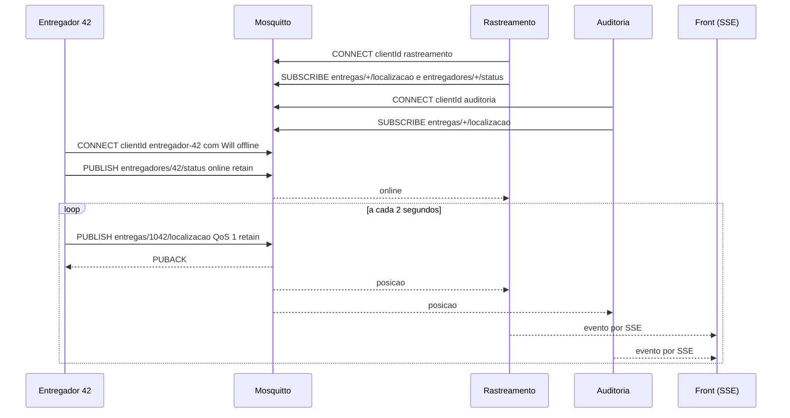

# Fluxo de execução da PoC MQTT

O caminho de uma posição do entregador até a tela. Os números entre parênteses são os quatro comportamentos do slide "PoC, o que vamos montar" (1 publicar e receber, 2 pub/sub, 3 retained, 4 Last Will).

## Caminho de uma mensagem

1. O `up --build` constrói a imagem e cria `mosquitto`, `app` e `entregador`.
2. O Mosquitto sobe primeiro, com `mosquitto/mosquitto.conf`. App e entregador esperam o healthcheck passar (`depends_on` com `service_healthy`).
3. O `main.ts` lê `MESSAGING_DRIVER=mqtt` e chama `bootstrapMqtt()`, que sobe o `MqttModule` na porta 3000 e serve a pasta `public`.
4. O `RastreamentoService` abre duas conexões, `rastreamento` e `auditoria`. Cada uma assina seus tópicos ao conectar. Logs `[rastreamento] conectado` e `[auditoria] conectado`.
5. O entregador conecta como `entregador-42`, levando o Will (`offline`, QoS 1, retain) no CONNECT. O broker guarda o Will sem publicar.
6. No `connect`, o entregador publica `online` retido em `entregadores/42/status`. O rastreamento recebe e loga `[rastreamento] entregadores/42/status online`.
7. A cada 2 segundos o entregador publica a posição em `entregas/1042/localizacao` com QoS 1 e retain (1). O broker responde PUBACK e guarda a mensagem como a retida do tópico.
8. O `+` de `entregas/+/localizacao` casa com `1042`, então o broker entrega a mesma mensagem às duas conexões, com `retain=false` (2).
9. Cada conexão registra o evento. O rastreamento extrai o pedido com `topico.split('/')[1]` e chama `atualizarLocalizacao('1042', lat, lon)`.
10. O registro vai para um `Subject` do RxJS, e o endpoint SSE `GET /mqtt/eventos` repassa ao navegador.
11. O front, que carregou `/mqtt/estado` antes de abrir o `EventSource`, atualiza a posição, redesenha o rastro e escreve uma linha no painel ou na auditoria, conforme `quem`.

## Diagrama

## Cenário retained (3)

1. O entregador publica toda posição com `retain: true`, e o broker guarda só a última de cada tópico.
2. No front, "Conectar novo assinante" faz `POST /mqtt/novo-assinante`.
3. O service abre uma conexão nova (`novo-assinante-<timestamp>`) e assina `entregas/1042/localizacao`.
4. O broker entrega a retida na hora, sem esperar os 2 segundos, com `packet.retain === true`.
5. O service fecha a conexão, emite o evento no SSE com `quem: novo-assinante` e responde com `retain: true`. O front anima a mensagem até a coluna do novo assinante. O log do app mostra `[novo assinante] recebeu entregas/1042/localizacao com retain=true`.

As mensagens ao vivo chegam com `retain=false`, então os logs normais não têm o sufixo `(retain)`. Se o app reiniciar (`restart app`), as conexões novas recebem posição e status retidos ao assinar, e aí o sufixo aparece.

## Cenário Last Will (4)

1. Com tudo rodando, o selo mostra `online`.
2. `docker compose -f docker-compose.mqtt.yml kill entregador` mata o container sem DISCONNECT, como um celular sem sinal.
3. O broker vê o TCP cair sem DISCONNECT e, em cerca de 1 segundo, publica o Will `offline` em `entregadores/42/status`, retido. Se a conexão ficasse muda sem fechar, ele esperaria o keepalive (60 segundos no padrão do mqtt.js).
4. O rastreamento recebe, loga `[rastreamento] entregadores/42/status offline` e o SSE leva ao front, que deixa o selo vermelho.
5. O `restart: on-failure` não religa container morto à mão. `docker compose -f docker-compose.mqtt.yml start entregador` reconecta, publica `online` e o selo volta a verde.

O `stop` também dispara o Will (testado). O Node termina com SIGTERM sem mandar DISCONNECT. A demo usa `kill` porque deixa claro que o entregador caiu sem se despedir.
