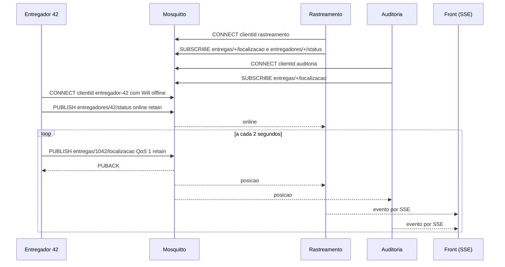

# Fluxo de execução da PoC MQTT

O caminho de uma posição do entregador até a tela, na ordem em que as coisas acontecem. Os números entre parênteses se referem aos quatro comportamentos do slide "PoC, o que vamos montar" (1 publicar e receber, 2 pub/sub, 3 retained, 4 Last Will).

## Caminho de uma mensagem

1. `docker compose -f docker-compose.mqtt.yml up --build` constrói a imagem e cria os três containers: `mosquitto`, `app` e `entregador`.
2. O Mosquitto sobe primeiro, lendo `mosquitto/mosquitto.conf` (porta 1883, acesso anônimo). O healthcheck roda um `mosquitto_pub` a cada 5 segundos até dar certo. Enquanto isso, `app` e `entregador` ficam em espera por causa do `depends_on` com `service_healthy`.
3. Com o broker saudável, o `app` inicia. O `main.ts` lê `MESSAGING_DRIVER=mqtt` e chama `bootstrapMqtt()`, que sobe o `MqttModule` na porta 3000 e serve a pasta `public`.
4. O `RastreamentoService` roda `onModuleInit` e abre duas conexões no broker, `rastreamento` e `auditoria`. Cada uma, ao conectar, assina seus tópicos com `entregas/+/localizacao` (a de rastreamento também assina `entregadores/+/status`). Logs: `[rastreamento] conectado` e `[auditoria] conectado`.
5. O `entregador` inicia e conecta com `clientId: 'entregador-42'` levando o Will (`offline`, QoS 1, retain) dentro do CONNECT. O broker guarda o Will, sem publicar nada ainda.
6. No evento `connect`, o entregador publica `online` (retain) em `entregadores/42/status`. O rastreamento recebe e loga `[rastreamento] entregador 42 está online`. Log do entregador: `[entregador 42] conectado em mqtt://mosquitto:1883, status online`.
7. A cada 2 segundos o entregador monta uma posição e publica em `entregas/1042/localizacao` com QoS 1 e retain. Log: `[entregador 42] entregas/1042/localizacao lat=-22.0084 lon=-47.8907`.
8. O broker recebe, responde com PUBACK ao entregador e guarda a mensagem como a retida do tópico, substituindo a anterior.
9. O broker procura assinantes cujo filtro case com o tópico. O `+` de `entregas/+/localizacao` casa com `1042`, então entrega a mesma mensagem às duas conexões do backend (comportamento 2). Como já estavam conectadas, chegam com `retain=false`.
10. O callback `on message` da conexão `rastreamento` registra o evento, extrai o pedido com `topico.split('/')[1]` e chama `atualizarLocalizacao('1042', lat, lon)`, que acrescenta o ponto ao rastro. O callback da `auditoria` registra o evento e o guarda na lista dos últimos 30. Logs: `[rastreamento] entregas/1042/localizacao {"lat":...}` e a mesma linha com `[auditoria]`.
11. Cada registro também vai para o `Subject` do RxJS. O endpoint SSE `GET /mqtt/eventos` repassa esse fluxo ao navegador.
12. O front, que abriu `EventSource('/mqtt/eventos')` depois de carregar `/mqtt/estado`, recebe o evento, atualiza o número da posição, redesenha o rastro SVG e escreve uma linha na lista do painel (ou da auditoria, conforme o campo `quem`).

## Diagrama

## Cenário retained (comportamento 3)

Objetivo: mostrar que quem chega depois recebe a última posição na hora.

1. O entregador publica toda posição com `retain: true`. O broker guarda só a última de cada tópico.
2. No front, clique em "Conectar novo assinante". O navegador faz `POST /mqtt/novo-assinante`.
3. O `RastreamentoService.novoAssinante()` abre uma conexão nova com `clientId` único (`novo-assinante-<timestamp>`) e assina `entregas/1042/localizacao`.
4. Assim que o broker aceita a assinatura, entrega a mensagem retida, sem esperar os próximos 2 segundos. O callback recebe com `packet.retain === true`.
5. O service fecha essa conexão e responde `{"topico":"entregas/1042/localizacao","payload":"{...}","retain":true}`. O painel mostra `retain: true`.
6. Log do app: `[novo assinante] recebeu entregas/1042/localizacao com retain=true`.

Dois detalhes para a explicação oral. As mensagens ao vivo das conexões antigas chegam com `retain=false`, por isso os logs normais não têm o sufixo `(retain)`. E se o app for reiniciado (`restart app`), as duas conexões novas recebem a posição e o status retidos logo ao assinar, e aí os logs mostram `(retain)`.

## Cenário Last Will (comportamento 4)

Objetivo: mostrar que o broker avisa que o entregador caiu mesmo sem ele conseguir avisar.

1. Com tudo rodando, o selo mostra `online`, o estado retido em `entregadores/42/status`.
2. Rode `docker compose -f docker-compose.mqtt.yml kill entregador`. O container morre na hora, sem nenhum DISCONNECT. Isso simula o celular perdendo sinal ou a bateria acabando.
3. O broker percebe que a conexão TCP caiu sem DISCONNECT e conclui que foi uma queda abrupta. Com o fim do TCP isso acontece em cerca de 1 segundo. Se a conexão ficasse muda sem fechar, o broker esperaria o keepalive vencer (60 segundos no padrão do mqtt.js).
4. O broker publica o Will que veio no CONNECT: `offline` em `entregadores/42/status`, com QoS 1 e retain.
5. A conexão `rastreamento` está assinada em `entregadores/+/status`, recebe e loga `[rastreamento] entregador 42 está offline`. O SSE leva ao front e o selo fica vermelho.
6. Como o Will também é retido, um assinante que entrar depois recebe `offline` na hora.
7. `restart: on-failure` não religa container morto por `kill` manual, então ele fica parado até você mandar. Rode `docker compose -f docker-compose.mqtt.yml start entregador`.
8. O entregador reconecta, publica `online` retido e volta a publicar posições. O selo fica verde.

Se em vez do `kill` o entregador fosse encerrado com `stop` ou `down`, o Node receberia SIGTERM e o processo simplesmente terminaria. O mqtt.js não manda um DISCONNECT limpo nesse caso, então o Will também dispara e o status vira offline (testamos com `stop`). Na apresentação usamos o `kill` porque deixa claro que o entregador caiu sem se despedir.
